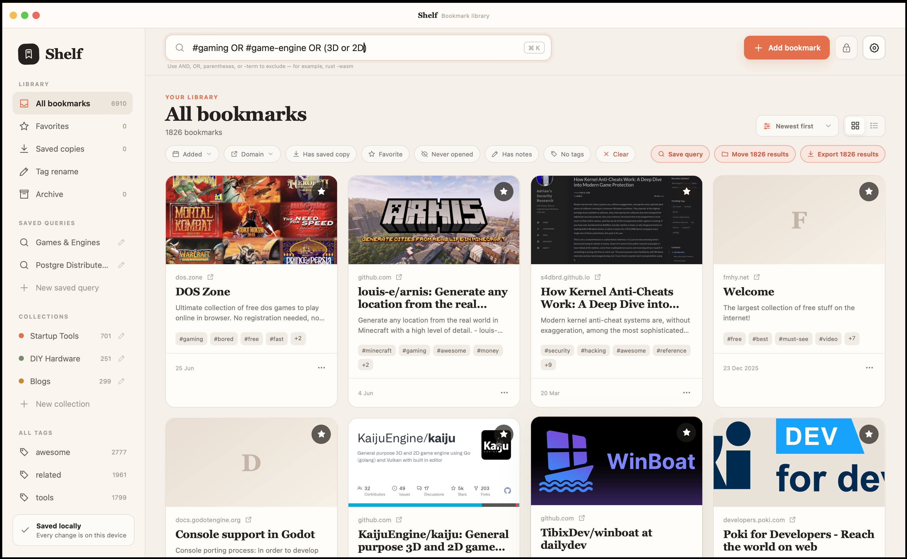
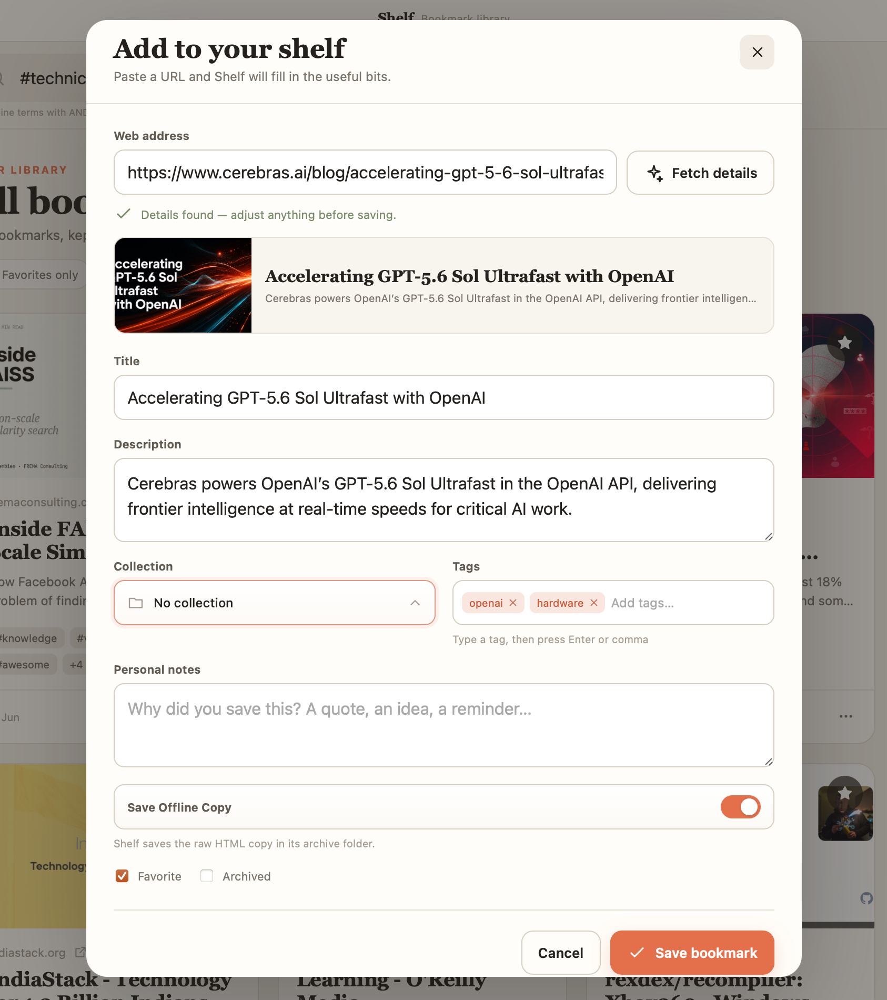

# Shelf

Shelf is a local-first desktop bookmark library built with Rust and Tauri 2. Paste a URL and it can retrieve the page title, description, Open Graph image, favicon, site name, author, and publication date.

## Screenshots

### Bookmark library in grid view



### Add a new bookmark



## Features

See [PRODUCT_FEATURES.md](PRODUCT_FEATURES.md) for a customer-focused overview or [FEATURES.md](FEATURES.md) for the complete technical feature catalog and current product boundaries.

- Automatic short-link expansion before saving and page metadata extraction over HTTPS with redirect limits, one retry after HTTP 429 rate limiting, and user-configurable request timeout and page-size limits under Settings → Miscellaneous
- Multiple tags with autocomplete, deduplication, tag navigation, and library-wide renaming
- Collections with custom colors and one-step bulk moves for current search results
- Debounced weighted fuzzy search across title, description, URL, domain, tags, collection, author, site name, and personal notes, with `AND`, `OR`, parenthesized expressions, and `-term` exclusions
- Named saved queries that rerun against the latest library whenever selected
- Virtualized grid/list views for smooth large libraries; date, title, domain, and visit-count sorting; and combinable filters for date added, domains through a searchable multi-select, saved copies, favorites, unopened bookmarks, notes, and missing tags
- Favorites, archive, personal notes, open count, and last-opened tracking
- Bookmark sharing with scannable QR codes plus link and full-detail clipboard copying
- Optional per-bookmark archiving as raw HTML
- Saved copies stored in filesystem-safe per-link folders beside the configured data file
- Full-text and fuzzy search across bookmark metadata and saved HTML
- One-click access to saved HTML copies rendered inside Shelf from each bookmark's actions menu
- Guided CSV import from Shelf and Raindrop.io exports, with validation before any library changes
- Native CSV export of the full library or current search results, with round-tripping for metadata, tags, collections, and visit history
- Optional password-based app lock with configurable inactivity timeout
- Optional HTTP API server with configurable bind interface and port
- In-memory state backed by a normalized local SQLite database, with mutations committed transactionally
- Native file dialogs and external browser opening
- Custom title-bar controls with double-click maximize/restore behavior across desktop platforms
- Responsive, offline-friendly interface with no remote font or UI dependencies, including monitor-aware window sizing for smaller displays
- Persistent 80–200% interface scaling for HiDPI displays, available from Settings → Appearance and standard Ctrl/Cmd zoom shortcuts

## Run locally

```sh
npm install
npm run tauri dev
```

Shelf's development frontend uses `http://127.0.0.1:1431`, with the port kept
fixed in Vite and Tauri so other local apps using port 1420 cannot supply Shelf's
frontend. Restart `tauri dev` after changing either development configuration.

Build a native installer for the current operating system:

```sh
npm run tauri build
```

Run the frontend production build and Rust compile checks:

```sh
npm run check
```

## GitHub releases

The [`release.yml`](.github/workflows/release.yml) workflow creates a GitHub release and builds native installers for:

- macOS Intel and Apple Silicon
- Linux x86_64 and ARM64
- Windows x86_64 and ARM64 as MSI packages and per-user NSIS setup installers

One minor note for the future: macos-14 (Apple Silicon) and ubuntu-22.04-arm are older images GitHub has been deprecating. If a future release run fails on "image not found", bumping to macos-15 / ubuntu-24.04-arm (and swapping libwebkit2gtk-4.1-dev → 4.0-dev is not needed on 24.04; 4.1 is still fine) is the fix.

### Make a release

1. Choose the next version, for example `0.2.0`. Keep it identical in `package.json`, `src-tauri/Cargo.toml`, and `src-tauri/tauri.conf.json`. A convenient way to update the npm files is:

   ```sh
   npm version 0.2.0 --no-git-tag-version
   ```

   Then update the two Tauri files and run `cargo check --manifest-path src-tauri/Cargo.toml` so the lockfile records the new app version.

2. Run the checks and commit the version change:

   ```sh
   npm run check
   git add package.json package-lock.json src-tauri/Cargo.toml src-tauri/Cargo.lock src-tauri/tauri.conf.json
   git commit -m "Release v0.2.0"
   git push origin main
   ```

3. Create and push the matching version tag:

```sh
git tag -a v0.2.0 -m "Release v0.2.0"
git push origin v0.2.0
```

Pushing a tag beginning with `v` starts the workflow. It creates a draft release, builds all six targets in parallel, uploads the installers, and publishes the release only when every build succeeds. If a build fails, the draft release is kept so the same workflow can be rerun by pushing the tag again.

Release assets are available from the repository’s **Releases** page. You can inspect a release with:

```sh
gh release view v0.2.0 --web
```

The macOS builds use ad-hoc signing because Apple Developer signing secrets are not configured. Users may need to approve the app under **Privacy & Security** on first launch. Windows builds are unsigned and may show a SmartScreen warning. The Windows NSIS setup installer installs Shelf for the current user under `%LOCALAPPDATA%` and does not require administrator permission; an MSI package is also available.

## Local data

By default, the database is named `shelf.sqlite3` inside the operating system's application-local-data directory. Its exact path is shown under **Storage**, where the user can also choose another folder and filename. Shelf copies the current library database and its `archives/` folder to the new location and remembers it for future launches. Each archived link gets a filesystem-safe folder containing its `page.html`, `content.txt`, and capture manifest. HTML archiving and metadata/search do not require a browser, and saved HTML is rendered in Shelf's embedded webview.

The optional app lock is configured from the **App lock** settings tab. Shelf stores only an Argon2 password hash in the app-local `security-preference.json`; the bookmark library and saved copies remain ordinary local files. When the inactivity timeout expires, the app blocks access until the password is entered again. The lock is intended for in-app privacy, not encryption at rest.

- macOS: `~/Library/Application Support/com.shelf.bookmarks/shelf.sqlite3`
- Windows: `%LOCALAPPDATA%\\com.shelf.bookmarks\\shelf.sqlite3`
- Linux: `$XDG_DATA_HOME/com.shelf.bookmarks/shelf.sqlite3` (normally `~/.local/share/com.shelf.bookmarks/shelf.sqlite3`)

Library changes use SQLite transactions with foreign-key integrity checks. Background saved-copy jobs are tracked in a local `pending-archives.json` queue beside Shelf’s storage preference and are removed as soon as their copy is complete. Existing custom storage files require explicit overwrite confirmation.

The [`ingest_raindrop.py`](ingest_raindrop.py) utility imports a Raindrop.io CSV export through the optional HTTP API (`python3 ingest_raindrop.py export.csv`, default API base URL `http://localhost:9876/api/v1`).

Under **Import / export**, choose an importer before selecting a file. Shelf shows the accepted format for that source, validates the entire CSV before changing the library, and reports invalid rows. If errors are found, the import can be stopped with no changes or continued with only valid rows. Shelf CSV accepts common aliases such as `link`, `name`, `labels`, `folder`, and `starred`; only a URL column is required. Raindrop.io exports map the supplied title, excerpt, cover, note, tags, favorite state, and creation time without fetching page metadata. Highlights and unknown fields are ignored.

## HTTP API

The optional API server is disabled by default and can be configured under **Settings → API server**. Bookmark listings use bounded offset/limit pagination and report the complete count, while writes support atomic batches of up to 1,000 bookmarks with optional per-item metadata fetching and caller-controlled merge behavior. Bookmarks created through the API appear automatically in an open Shelf window after a short, burst-friendly delay. See [API.md](API.md) for the complete endpoint contract, request and response shapes, curl examples, error codes, and security considerations.

## Cross-platform notes

The application code does not call platform-specific shells or hard-code paths. Tauri resolves the app data directory, native file dialogs, URL opening, and installer formats for each target. Network fetching uses Rustls, avoiding an OpenSSL runtime dependency. Build Windows installers on Windows and Linux packages on Linux (or use CI), since native Tauri bundles are normally produced on their target OS.

## License

MIT — see [LICENSE](LICENSE).

### Retry a missing tag-triggered release run

If a pushed version tag does not create a GitHub Actions run, manually dispatch
the release workflow with the existing tag:

```sh
gh workflow run release.yml --repo goodappsstore/shelf-bookmaring-app --ref main -f release_tag=v0.1.1
```

Replace `v0.1.1` with the intended existing tag. The workflow verifies that the
tag exists and checks out that tag for every native build.
